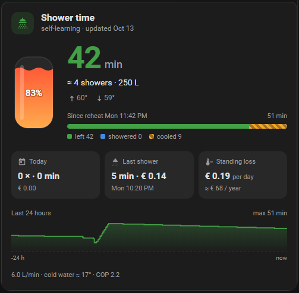
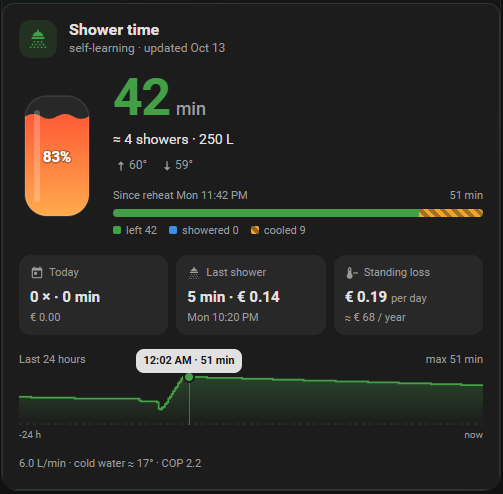

# Hot Water Shower Time

<a href="https://my.home-assistant.io/redirect/hacs_repository/?owner=Akashironld&repository=ha-shower-time&category=integration"></a>
<a href="https://ko-fi.com/akashironl/?hidefeed=true&widget=true&embed=true"></a>

**How long can I still shower?** A self-learning Home Assistant integration that turns the temperature
sensors of your hot water tank into minutes of showering — and gets better every night by learning from
your own showers.

<p align="center"></p>

- 🚿 **Shower time**, **showers left**, **hot water in litres** and **tank charge (%)**
- ⏱️ **Live while you shower** — counts down between sensor readings and corrects itself on every reading
- 🧠 **Learns by itself**: your shower flow, how your tank layers, when it really runs cold, standing
  losses, how fast it reheats, and the cold water temperature from the outdoor temperature
- 📒 **Shower log**: showers today, shower time today / this week, last shower
- 💶 **Cost per shower** — also with **dynamic tariffs**: the price of the electricity at the moment the
  tank was *reheated* is used, not the price when you shower
- 🔔 **Almost empty**, **hot water in use** and **full again at** for automations
- 🍽️ **Shower or washing up?** Tells a shower from the kitchen tap by how much heat it takes (or right away with
  a bathroom humidity sensor or a smart plug on the bathroom fan) — only showers count as showers
- 🔮 **Enough for today?** It learns when you usually shower and warns when the hot water will run out before
  the last shower of the day
- 🛁 **The shower going on now** (minutes and cost so far) and a **Shower** event after every shower — ready-made
  **blueprints** for a shower timer, a light that flashes when the water runs low, and a summary on your phone
- 💧 **Leak and insulation watch**: measures how much heat the tank loses while nothing happens, and notices a
  dripping hot tap or insulation that got worse
- 🦠 **Legionella watch**: when was the whole tank last at 60 °C?
- 📈 **Totals for the long run** (showers, minutes, electricity, cost), also in the energy dashboard
- 🩺 **Health checks** in *Settings → Repairs*: a tank sensor that stopped reporting, top and bottom swapped,
  learning that keeps failing
- 🎨 **Dashboard card included** (no separate download): tank graphic with the hot layer, countdown,
  showers left, a 24-hour graph you can hover/touch, and today's showers with cost
- ⚙️ **Easy setup**: pick the tank sensors; the rest is suggested from the same device
  (works out of the box with the Weheat integration)

## How it works

A hot water tank is layered: hot water floats on cold water. While you shower, cold water enters at the
bottom and pushes the hot layer out at the top. The water at the tap stays hot until that boundary reaches
the outlet — then it goes cold quickly.

From the top and bottom sensor the integration estimates the heat in the tank, works out when the outlet
can no longer reach shower temperature, and divides the usable heat by what one minute of showering costs.
Every night at 03:45 it looks back at the reheat cycles and showers since the last run and nudges its
parameters towards what it saw. The starting knowledge only gives way slowly, so one odd day does not throw
it off.

It was developed and validated on 13 months of minute data of a Weheat heat pump with the Weheat 200 L
tank (449 reheat cycles, 471 showers). That data is available as the *Weheat 200 L* starting profile;
other tanks start from a generic profile and learn their own behaviour.

| What it learns | From |
| --- | --- |
| Heat per minute of showering (≈ shower flow) | heat drawn between two full reheats vs. the minutes cold water was coming in |
| Tank layering | reheats from a layered tank (needs a heat/energy sensor) |
| When the tank is really empty | reheats that start from an almost empty tank |
| Cold water temperature | how cold the bottom gets in long showers, against a 3-week outdoor average |
| Standing loss | quiet hours without showers or reheating |
| Reheat speed | every reheat |
| Typical shower length | the showers it sees |
| COP for hot water | heat and electricity meters over 30 days (optional) |

### Smart heat pump controllers

Controllers that heat the tank to different temperatures or top it up during the day (e.g. Weheat
Intelligence) are handled: a **complete** reheat (top and bottom within 2.5 °C) sets the new 100 %, also
when it heats to a lower temperature than last time; a **partial** top-up only raises the level. The
learning skips periods with a top-up in between, so it does not learn a too-low flow.

### Cold water temperature

Mains water follows the ground, which follows the weather weeks later: a few warm days hardly matter, a
cold month does. With an outdoor temperature sensor the model uses **cold water ≈ a + b × 3-week outdoor
average** and learns *a* and *b* from long showers (the slope only once the data spans the seasons).
Without one it uses a learned monthly table that changes smoothly between months.

## Shower temperature: automatic, sensed or set

The tank only feels **heat per minute** = flow × (shower temperature − cold water). A 6 L/min shower at
40 °C and a 7 L/min shower at 37 °C cost the tank exactly the same, so no calculation on tank data alone
can tell them apart. That is fine for the minutes — they only depend on the heat per minute, which is
learned — so by default you do not have to know your shower temperature at all.

| Setting | Shower temperature | Litres |
| --- | --- | --- |
| **Automatic** (default) | not needed — litres are shown at a 38 °C reference | estimated |
| + **water meter / flow sensor** | **sensed**: cold water + learned heat ÷ measured flow while you shower | measured |
| + **shower-head type** (water-saving 6 / normal 8 / rain 12 L/min) | calculated | from the type |
| + **flow filled in yourself** | calculated | from your value |
| **Set it myself** | your fixed value | estimated |

With a known flow you get an extra `sensor.<name>_shower_temperature` ("you shower at ≈ 39.4 °C"). Expect
about ±1–2 °C at first.

### Measuring your shower-head flow (one minute, one bucket)

1. Turn the shower on the way you normally shower — same temperature, same tap position.
2. Hold a bucket under the shower head and time how many seconds it takes to collect **10 litres**.
3. Flow in L/min = **600 ÷ seconds** (50 s = 12, 75 s = 8, 100 s = 6 L/min).

No bucket with litre marks? Catch the water for 10 seconds, measure it with a jug and multiply by 6.

## Cost per shower

Choose any electricity price sensor in the options (€/kWh, ct/kWh or €/MWh; from your supplier, Nord Pool,
Tibber, evcc, …). **Use an all-in price** (including taxes) — a bare spot price gives far too low costs.

With dynamic tariffs you pay when the tank is **reheated**. The integration keeps a price for the hot water
in the tank: heat a reheat adds is booked at the price of that moment ÷ COP, blended with the heat already
in the tank. A shower costs the heat it takes out × that price. The COP is learned from the heat and
electricity meters for hot water when available (both suggested automatically for Weheat), otherwise the
value you set (heat pump ≈ 2–3.5, electric boiler 1.0).

## Smart extras

### Shower or washing up?

The tank only sees heat leaving, so at first a shower and the kitchen tap look the same. They differ in how much
heat they take: washing up a few tenths of a degree of the tank average, a shower several degrees at a steady pace;
a bath or bucket filled with hot water only goes about three times faster than a shower. So a use shows as
**HOT WATER** on the card first, and becomes **SHOWERING** once enough heat has left at a shower's pace — a few
minutes, depending on how often your sensors report. With a **bathroom signal** (a humidity sensor, a smart plug on
the bathroom fan, or a fan or light that switches on) it is recognised within a minute; with a **water meter** a
steady, shower-like flow confirms it after two minutes and the meter's start and stop make the length exact (cold
water alone, like a toilet, never counts). The threshold between your taps and your showers is learned per
household.

Water drawn from the tank is replaced by cold water at the bottom, so the top stays hot while you shower. When the
top falls while the bottom is still warm — a heat pump starting a reheat, or heat taken out through the coil — no
water was drawn and it is not counted at all.

Only showers go in the shower log, the habits and the shower totals. Everything else is counted as *Other hot water
today* (heat, how often, cost) and fires `hot_water_used` on the Shower event. *Showering* is on only for a
recognised shower; *Hot water in use* for any use.

### Enough for today?

Every day the integration adds the minutes you showered per hour to a profile of your household — per weekday,
so a Saturday morning shower is expected on Saturdays only. After a week it compares the shower minutes still
expected today with what the tank holds now, minus the standing loss until then:
**Enough for today** turns off and the card shows **EMPTY BY 21:30** when the hot water will not last — in time
to reheat. It assumes no reheat in between; if your heat pump reheats on its own when the tank runs low, use it
as advice. *Shower time expected today* gives the minutes and the next likely shower.

### The shower going on now

*Current shower* counts the minutes of the shower going on (0 otherwise) and what that hot water costs so far.
The **Shower** event entity fires `shower_started` and, for a real shower (4–40 minutes), `shower_ended` with
`minutes`, `heat_kwh`, `electricity_kwh`, `cost` and `currency` — see the blueprints below.

### Totals and the energy dashboard

*Showers total*, *Shower time total*, *Shower electricity total* and *Shower cost total* only ever go up, so Home
Assistant keeps their history forever: showers and costs per week, month or year in the statistics graph card.
*Shower electricity total* can be added to the **energy dashboard** as an individual device.

### Leak and insulation watch

Every day the integration looks for a quiet stretch of at least three hours (no reheat, no hot water use, the
layers settled) while the tank is evenly hot, and measures how fast it cools. Divided by how much warmer the tank
is than the room, that gives the tank's **heat-loss coefficient** in W/K — independent of how hot the tank happens
to be, so it can be compared over months. *Tank heat loss* shows what that costs right now in watts
(for example about 70 W for a 200 L tank at 55 °C).

- **Raised heat loss** turns on when the coefficient is clearly higher (×1.4) than your tank's own baseline in 3 of
  the last 4 measurements: insulation that came loose or got wet, a pipe that now loses heat, a colder spot.
- A **dripping hot tap** or a leak lets cold water trickle in at the bottom: night after night the bottom cools
  faster than the top, without the quick drop a tap gives. That is checked every night between 01:00 and 05:00 and
  works from the first nights; it also turns on *Raised heat loss* with the attribute `leak_like`.

Both also show up in **Settings → Repairs** with what to check. The baseline needs about 11 measured days.

### Legionella watch

*Last legionella heat-up* is the last time the whole tank — top **and** bottom — was at 60 °C or more (found in
the statistics of the past 45 days on the first start). *Legionella heat-up overdue* turns on after 8 days without
one. Both numbers can be changed under **Configure**.

### Health checks

In **Settings → Repairs** you get a notice when a tank sensor has not reported for two hours, when the bottom has
been warmer than the top for six hours (sensors swapped), or when learning failed three nights in a row.

## Requirements

- Home Assistant 2025.1 or newer with the recorder (default). The logo shows from Home Assistant 2026.
- A temperature sensor at the **top** of the tank. A **bottom** sensor is strongly recommended: without it
  the model cannot see showers, so the live countdown, the shower log and most of the learning do not work.
- Optional, each makes it smarter: an entity that shows the tank is being reheated, a heat (energy) sensor
  for hot water, an electricity sensor for hot water, an outdoor temperature sensor, a water meter, a price
  sensor.
- °C and °F sensors both work.

## Installation

[](https://my.home-assistant.io/redirect/hacs_repository/?owner=Akashironld&repository=ha-shower-time&category=integration)

1. Click the button above (or in HACS: ⋮ → **Custom repositories** → add
   `https://github.com/Akashironld/ha-shower-time`, category *Integration*)
2. **Download** Hot Water Shower Time and restart Home Assistant
3. Add the integration — click the button below, or **Settings → Devices & services → Add integration → Hot Water
   Shower Time**

[](https://my.home-assistant.io/redirect/config_flow_start/?domain=shower_time)

## Configuration

The setup has two screens. Only the first one needs input; the second is filled in for you where possible
(for Weheat everything is suggested) and can be left as it is.

### Screen 1 — the tank

| Setting | | What it is for | Weheat example |
| --- | --- | --- | --- |
| **Name** | required | Name of the device and the start of the entity ids | `Hot water` |
| **Top temperature sensor** | **required** | Temperature at the top of the tank (the outlet side) | `sensor.…_dhw_top_temperature` |
| **Bottom temperature sensor** | strongly recommended | Sees cold water coming in while you shower. Without it: no live countdown, no shower log and hardly any learning | `sensor.…_dhw_bottom_temperature` |
| **Tank volume** | **required** | Litres, from the type plate | `200` |
| **Shower temperature** | required, default *Automatic* | *Automatic* needs nothing; *Set it myself* uses the fixed value below it | Automatic |

### Screen 2 — make it smarter (all optional)

| Setting | What it adds | Without it | Weheat example |
| --- | --- | --- | --- |
| **Starting knowledge** | Where the model starts before it has learned from your showers | *Generic tank* | *Weheat 200 L* (suggested automatically) |
| **Entity that shows reheating** + **states** | Exact reheat moments, "Reheating" sensor, "Full again at" | Reheats are recognised from the temperature rising | `sensor.blackbird_p80_heat_pump` with `dhw, legionella_prevention` |
| **Heat delivered to hot water** (energy) | Learns how your tank layers; more precise flow | Fixed layering from the starting knowledge | `sensor.…_energy_output_dhw` |
| **Outdoor temperature sensor** | Cold water temperature from the 3-week outdoor average | Learned monthly table | `sensor.…_outside_temperature` |
| **Electricity used for hot water** (energy) | Learns the COP for the cost per shower | The COP you fill in | `sensor.…_electricity_used_dhw` |
| **COP for hot water** | Used when the COP cannot be learned | 2.5 | heat pump ≈ 2–3.5, electric boiler 1.0 |
| **Electricity price sensor** | Cost per shower and per day (use an all-in price) | Only kWh, no money | your supplier, Nord Pool, Tibber, evcc… |
| **Shower-head flow** | *Water meter*, *type* or *fill in myself*: litres and the temperature you shower at | Litres at a 38 °C reference | *I don't know* |
| **Flow, filled in yourself** | Only with *Fill in myself* (bucket method above) | — | `7.2` |
| **Water meter or flow sensor** | A shower is recognised quickly by a steady flow of water and its length is exact; with *Water meter* above it also measures the shower-head flow | — | a meter total in L or m³ |
| **Bathroom signal** | A shower is recognised within a minute: bathroom humidity, the power of the bathroom fan, or a fan, light or motion sensor (suggested when one has *bathroom* in its name) | Recognised by its heat after a few minutes | a smart plug on the bathroom fan: `sensor.…_power` |

### Change it later

**Settings → Devices & services → Hot Water Shower Time → Configure** lets you change everything except the name,
the top sensor and the starting knowledge, plus the **"Almost empty" threshold** (default 10 minutes) and the
**legionella temperature and days** (default 60 °C and 8 days). The model keeps what it learned.
To start learning from scratch, remove the integration and add it again.

### Good to know

- The first estimate is there right away; the first learning run follows two minutes after setup and then every
  night at 03:45 (or press **Learn now**).
- The shower log is filled with the past week from your history on the first start.
- The card is added from the dashboard editor: search for **Shower time**.

## Entities

A few niche sensors start switched off (*Showers left*, *Hot water*, *Shower temperature*, *Shower time this week*,
*Shower time expected today*, *Showers total*, *Shower time total*); switch them on under Settings → Entities.

| Entity | |
| --- | --- |
| `sensor.<name>_shower_time` | minutes of showering left; the card reads all details from its attributes |
| `sensor.<name>_showers_left` | showers of your typical length |
| `sensor.<name>_hot_water` | litres at shower temperature |
| `sensor.<name>_tank_charge` | % — 100 % right after the last complete reheat |
| `sensor.<name>_showers_today`, `_shower_time_today`, `_shower_time_this_week`, `_last_shower` | shower log |
| `sensor.<name>_shower_cost_today` | cost of today's showers (with a price sensor) |
| `sensor.<name>_full_again_at` | while reheating: when the tank is full again (attribute: enough for one shower) |
| `sensor.<name>_shower_temperature` | with a known shower-head flow or a fixed temperature |
| `binary_sensor.<name>_almost_empty` | below the threshold (default 10 min) |
| `binary_sensor.<name>_hot_water_in_use` | hot water is being drawn now (a shower, washing up, a tap) |
| `binary_sensor.<name>_reheating` | the tank is being reheated (with a reheat entity) |
| `binary_sensor.<name>_showering` | someone showers now (recognised as a shower, not washing up) |
| `sensor.<name>_current_shower` | minutes of the shower going on now (0 otherwise); attributes: cost so far |
| `event.<name>_shower` | `shower_started` (once recognised) / `shower_ended` (with minutes, kWh and cost) / `hot_water_used` (other use) |
| `sensor.<name>_other_hot_water_today` | heat of today's hot water that was not a shower; attributes: how often, cost |
| `binary_sensor.<name>_enough_for_today` | on when the hot water lasts for today's usual showers (after a week) |
| `sensor.<name>_shower_time_expected_today` | shower minutes still expected today; attributes: runs out at, next shower |
| `sensor.<name>_showers_total`, `_shower_time_total`, `_shower_electricity_total`, `_shower_cost_total` | totals for long-term statistics and the energy dashboard |
| `sensor.<name>_tank_heat_loss` | watts the tank loses now; attributes: coefficient (W/K) and baseline |
| `binary_sensor.<name>_raised_heat_loss` | the tank loses clearly more heat than it used to, or a drip pattern (`leak_like`) |
| `sensor.<name>_last_legionella_heat_up` | the last time the whole tank was at the legionella temperature |
| `binary_sensor.<name>_legionella_heat_up_overdue` | longer ago than the set number of days |
| `sensor.<name>_learned_model` | diagnostic: everything learned so far |
| `button.<name>_learn_now` | learn from the history right away |

## Dashboard card

Add a card and search for **Shower time**, or use YAML:

```yaml
type: custom:shower-time-card
entity: sensor.hot_water_shower_time
```

Every part can be switched off, in the visual editor or in YAML:

| Option | Part | Default |
|---|---|---|
| `title` | your own title | *Shower time* |
| `compact` | hide everything except the tank and the minutes — handy on a wall tablet | `false` |
| `show_tank` | tank graphic filled to the charge level | `true` |
| `show_temps` | top and bottom temperature | `true` |
| `show_split` | *Since reheat* bar: left / showered / cooled | `true` |
| `show_tiles` | tiles *Today*, *Last shower*, *Standing loss* | `true` |
| `show_history` | last 24 hours (hover or touch to read values) | `true` |
| `show_footer` | bottom line: flow, cold water, COP | `true` |
| `show_problems` | warnings: possible leak, raised heat loss, late legionella heat-up, silent sensor (also in compact) | `true` |

A `show_…` option you set yourself always wins, so you can start from `compact` and add a part back:

```yaml
type: custom:shower-time-card
entity: sensor.hot_water_shower_time
compact: true
show_tiles: true
```

The graph is filled from the tank sensors' history, so it is complete from the first day. Hover or touch it to read
the value at any moment:

<p align="center"></p>

What you see: the tank filled to its charge level, the minutes of showering left, roughly how many showers and
litres that is, where the hot water went since the last reheat (left / showered / cooled), today's showers and
their cost, the last shower, what standing loss costs per day, and the last 24 hours.

**Styling:** the card is a standard `ha-card`, so your theme (`ha-card-background`, `ha-card-border-radius`,
`ha-card-box-shadow`, …) applies, and [card-mod](https://github.com/thomasloven/lovelace-card-mod) works as on any
other card:

```yaml
type: custom:shower-time-card
entity: sensor.hot_water_shower_time
card_mod:
  style: |
    ha-card {
      background-color: rgba(36, 37, 41, 0.3);
      box-shadow: none;
      border: none;
    }
```

## Blueprints

Ready-made automations — click a button to import one into Home Assistant, then fill in the blanks:

| Blueprint | |
| --- | --- |
| **Hot water almost gone** — flash lights in a colour (and/or your own actions) when the hot water runs low | [](https://my.home-assistant.io/redirect/blueprint_import/?blueprint_url=https%3A%2F%2Fgithub.com%2FAkashironld%2Fha-shower-time%2Fblob%2Fmain%2Fblueprints%2Fautomation%2Fshower_time%2Fhot_water_low.yaml) |
| **Shower timer** — flash lights or announce something after a number of minutes in the shower | [](https://my.home-assistant.io/redirect/blueprint_import/?blueprint_url=https%3A%2F%2Fgithub.com%2FAkashironld%2Fha-shower-time%2Fblob%2Fmain%2Fblueprints%2Fautomation%2Fshower_time%2Fshower_timer.yaml) |
| **Shower summary** — a notification after every shower with its minutes and cost | [](https://my.home-assistant.io/redirect/blueprint_import/?blueprint_url=https%3A%2F%2Fgithub.com%2FAkashironld%2Fha-shower-time%2Fblob%2Fmain%2Fblueprints%2Fautomation%2Fshower_time%2Fshower_summary.yaml) |
| **Hot water will not last today** — a warning (and/or start a reheat) when today's showers will not fit | [](https://my.home-assistant.io/redirect/blueprint_import/?blueprint_url=https%3A%2F%2Fgithub.com%2FAkashironld%2Fha-shower-time%2Fblob%2Fmain%2Fblueprints%2Fautomation%2Fshower_time%2Fnot_enough_today.yaml) |

Lights that flash return to how they were afterwards. Or build your own with the **Shower** event:

```yaml
triggers:
  - trigger: state
    entity_id: event.hot_water_shower
conditions:
  - "{{ trigger.to_state.attributes.event_type == 'shower_ended' }}"
actions:
  - action: notify.notify
    data:
      message: "Showered {{ trigger.to_state.attributes.minutes | round }} min"
```

## Reporting a problem

Open an [issue](https://github.com/Akashironld/ha-shower-time/issues/new/choose) and attach the **diagnostics
file**: *Settings → Devices & services → Hot Water Shower Time → ⋮ → Download diagnostics*. It contains the
settings, what has been learned and the tank readings of the last 24 hours (no passwords or personal data), so
your situation can be replayed exactly.

## Development

Two sets of tests run on every push:

- `tests/` — the tank model, the forecast, heat loss and the shower/washing-up judgement, in plain Python
  (`pip install pytest && pytest tests --ignore=tests/ha`)
- `tests/ha/` — the integration inside a real test Home Assistant: setup, a shower followed live, washing up,
  the water meter, repairs, the setup and options screens (`pip install -r requirements_test.txt && pytest`,
  Python 3.14)

Dependabot proposes updates of the test Home Assistant and the CI actions every week. To release, add a section
`## vX.Y.Z — title` to CHANGELOG.md, set the same version in `manifest.json` and push the tag `vX.Y.Z`: the release
is published from the changelog.

## Limitations

- Without a bottom sensor showers are hard to see: no live countdown or log, little learning.
- Costs are in electricity; a gas-heated tank is not supported for cost.
- The cold water starting values are for the Netherlands/Belgium/Germany; elsewhere the model learns the
  local values, but starts a few degrees off.
- Live updates follow your sensors: with readings every few minutes the countdown runs on its own for up to
  4 minutes between readings.
- *Enough for today* does not know when your heat pump will reheat on its own; treat it as advice.
- The heat-loss watts assume the tank stands in a room of about 20 °C; the trend (and the alarm) does not depend
  on that. A tank that is never evenly hot (no full reheats) gives no heat-loss measurements.
- The legionella watch only sees the two sensors; it cannot tell whether the pipes were flushed hot.

## Nederlands

Hoe lang kan ik nog douchen? Deze integratie rekent de temperatuursensoren van je boiler om naar minuten
douchen en leert elke nacht van jullie eigen douches: het debiet, hoe de boiler gelaagd is, de
koudwatertemperatuur (uit de buitentemperatuur), wanneer de boiler echt leeg is en hoe snel hij opwarmt.
Met live aftellen tijdens het douchen, een douchelogboek, kosten per douche (ook bij een dynamisch tarief:
de prijs op het moment van opwarmen telt), vulgraad, "weer vol om" en een dashboardkaart. Volledig
Nederlandstalig in Home Assistant.

<p align="center"></p>

**Installeren:** klik op de knop *Open in HACS* bovenaan (of HACS → ⋮ → **Aangepaste repositories** →
`https://github.com/Akashironld/ha-shower-time`, categorie *Integratie*), download, herstart Home Assistant en
voeg de integratie toe via **Instellingen → Apparaten en diensten → Integratie toevoegen → Hot Water Shower Time**.

**Instellen:** alleen de **temperatuursensor bovenin** en de **inhoud van de boiler** zijn verplicht. Een **sensor
onderin** is sterk aanbevolen (zonder ziet het model geen douches). Al het andere is optioneel en wordt bij Weheat
automatisch voorgesteld: opwarmstand, warmte- en stroommeter voor warm water, buitentemperatuur, prijssensor en het
debiet van de douchekop. Achteraf wijzigen kan via **Instellingen → Apparaten en diensten → Hot Water Shower Time →
Configureren**.

Debiet van je douchekop meten: zet de douche aan zoals je normaal doucht, houd een emmer eronder en kijk
hoeveel seconden het duurt tot er 10 liter in zit. Debiet = 600 ÷ seconden (75 s = 8 L/min).

**Slimme extra's:**
- **Douche of afwas?** Warm water verschijnt eerst als **WARM WATER** op de kaart en wordt **DOUCHT NU** zodra er
  genoeg warmte in douchetempo uit het vat is gegaan (een paar minuten). Met een **badkamersignaal** (vochtigheid,
  een slimme stekker op de badkamerventilatie, of een ventilator of lamp) binnen een minuut. Afwas en kranen tellen
  apart als *Overig warm water vandaag*; een warmtepomp die opstart telt helemaal niet.
- **Genoeg voor vandaag?** Hij leert wanneer jullie douchen (per weekdag) en waarschuwt als het warme water op
  raakt vóór de laatste douche van de dag; de kaart toont dan bijvoorbeeld **OP OM 21:30**.
- **Huidige douche** (minuten en kosten tot nu toe) en een **Douche**-gebeurtenis na elke douche.
- **Lek- en isolatiewacht**: meet hoeveel warmte het vat verliest als er niets gebeurt (in W/K, onafhankelijk van hoe
  heet het vat is) en ziet een druppelende warmwaterkraan aan het patroon: 's nachts koelt de onderkant gestaag
  sneller af dan de bovenkant. Melding onder *Instellingen → Reparaties*.
- **Legionellawacht**: wanneer was het hele vat (boven én onder) voor het laatst 60 °C?
- **Totalen** voor de lange termijn (douches, minuten, stroom, kosten), ook in het energiedashboard.
- **Gezondheidscontroles** onder *Reparaties*: een sensor die niets meer geeft, boven en onder verwisseld, leren dat
  steeds mislukt.
- **Blueprints** (zie boven) voor een douchetimer, een lamp die knippert als het warme water bijna op is, een
  samenvatting na het douchen en een waarschuwing als het vandaag niet genoeg is.

## Support

Hot Water Shower Time is free and open source. If it saves you a cold shower (or some money) and you'd like to
say thanks, you can buy me a coffee ☕ — the button opens the Ko-fi tip panel straight away, no account needed:

<a href="https://ko-fi.com/akashironl/?hidefeed=true&widget=true&embed=true"></a>

Vind je het handig? Een koffie via [Ko-fi](https://ko-fi.com/akashironl/?hidefeed=true&widget=true&embed=true) wordt zeer gewaardeerd. ☕

## License

MIT
